<div align="center">


# Lumora TV

**A fast, remote-friendly IPTV player for Samsung Smart TVs (Tizen).**
Bring your own M3U playlist, Xtream Codes account or Stalker portal — Lumora handles the rest.


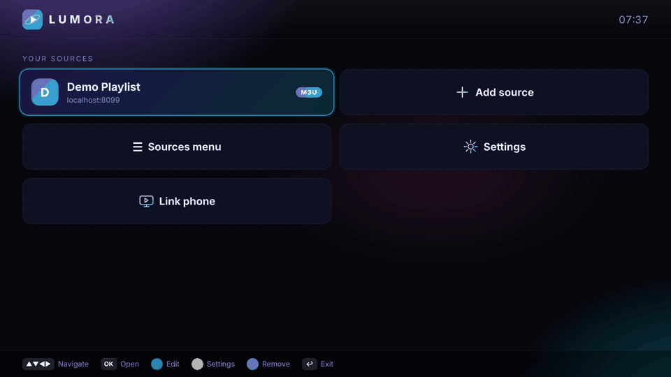

[](https://github.com/mejri02/Lumora-TV_tizen/releases/latest/download/Lumora-TV.wgt)

</div>

> **Disclaimer:** Lumora TV is only a player. It ships with no channels, playlists or content, and you are responsible for the sources you add and for having the right to watch them.

---

## Screenshots

| | |
|---|---|
| 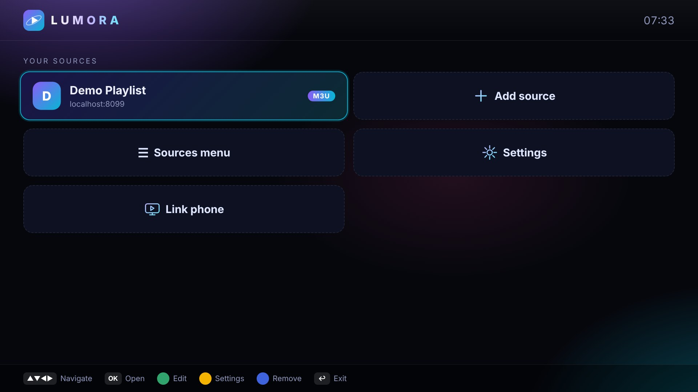 | 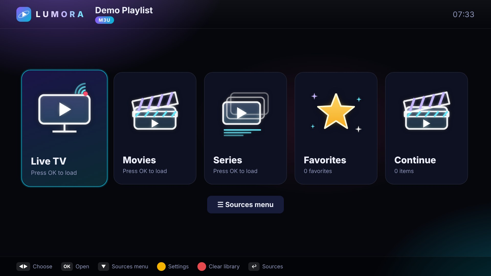 |
| **Sources** — all your playlists and accounts in one place | **Main menu** — Live TV, Movies, Series, Favorites, Continue |
| 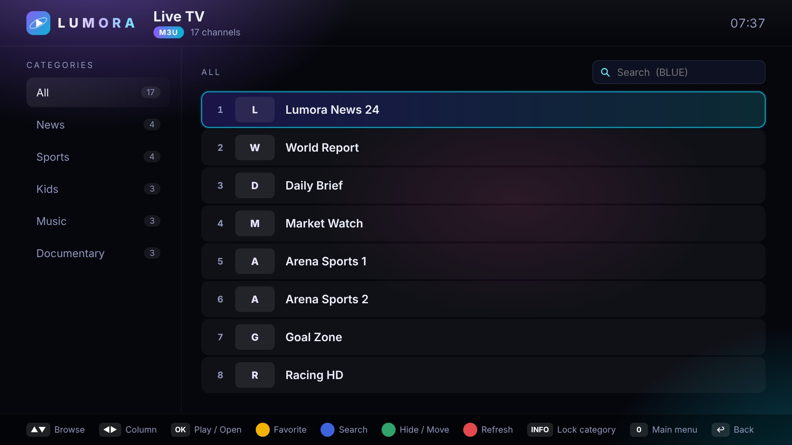 | 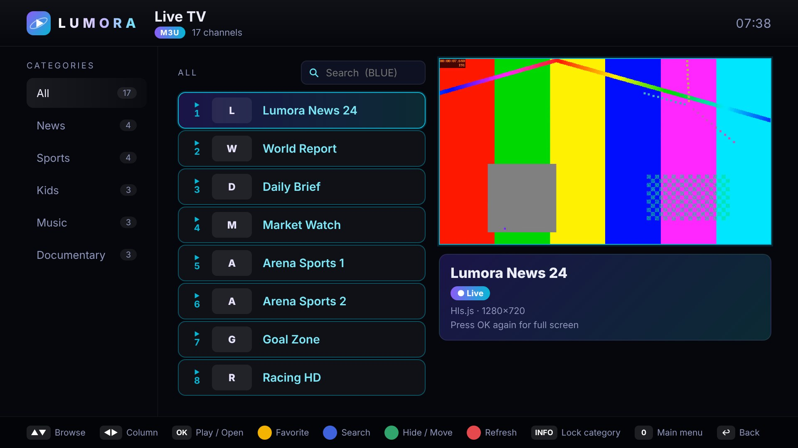 |
| **Channels** — categories, counts and instant search | **Live preview** — press OK once to preview, again for full screen |
|  | 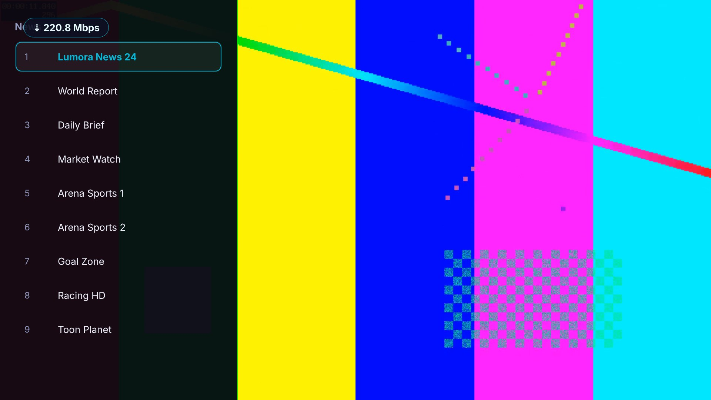 |
| **Full screen** playback | **Channel overlay** while watching |
| 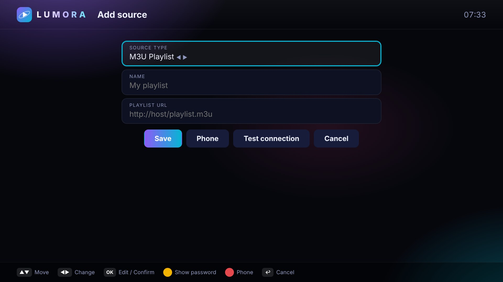 | 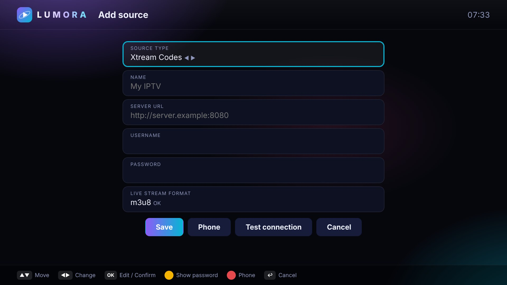 |
| **Add source** — M3U playlist | **Add source** — Xtream Codes |
| 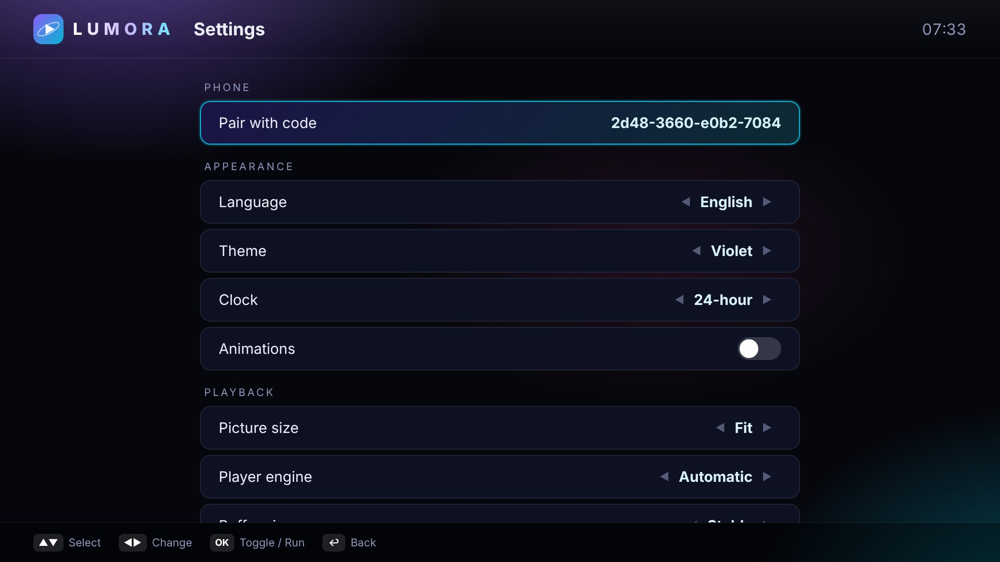 | 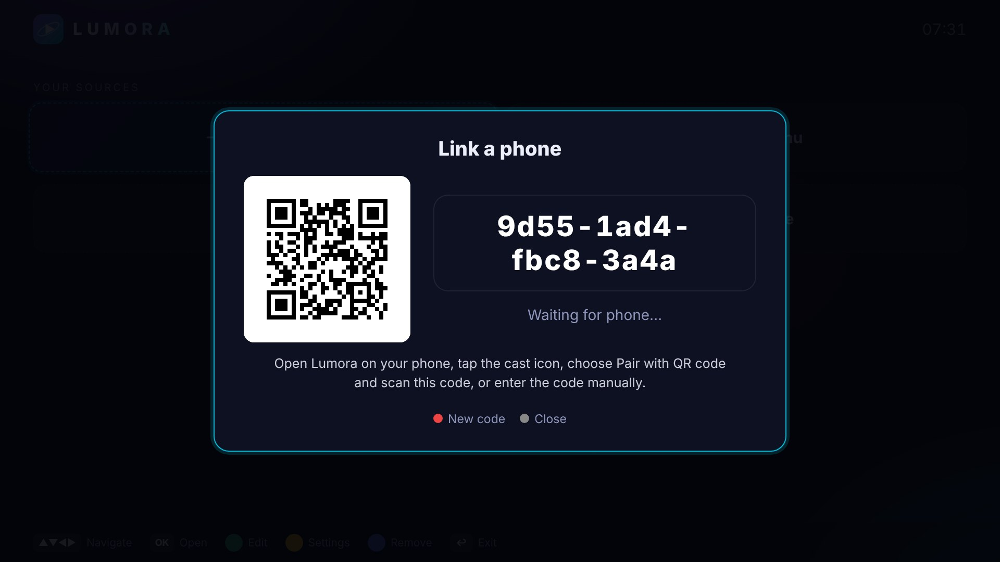 |
| **Settings** | **Link a phone** — pair by QR code or code |
| 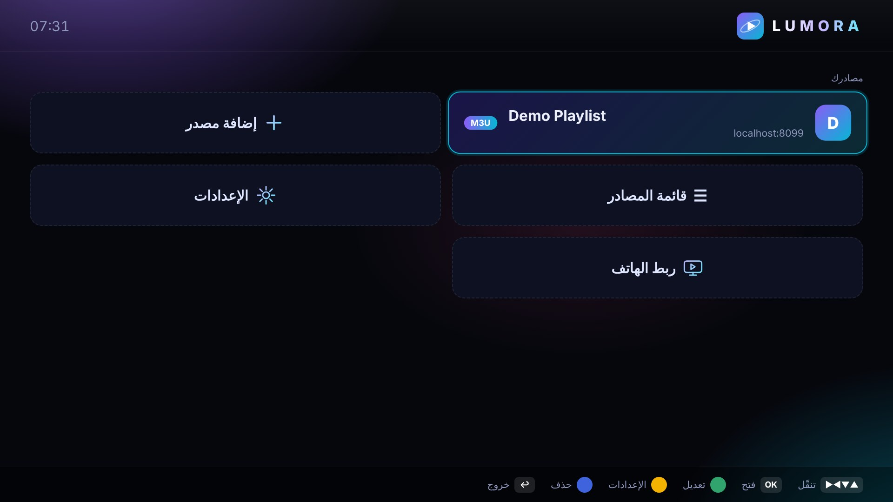 | 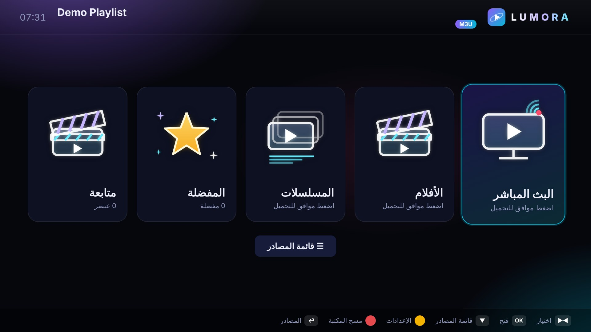 |
| **Arabic** with full right-to-left layout | **Arabic** main menu |

### Themes

16 built-in themes, including a few image-based ones. A selection:

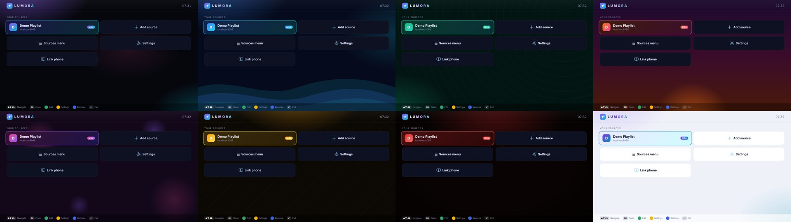

> The screenshots above were captured with a local demo playlist (test pattern streams), not real channels.

---

## Features

- **Three source types** — M3U / M3U8 playlists, Xtream Codes accounts, Stalker (MAC) portals. Multiple sources, switch any time.
- **Live TV, Movies, Series** with categories, channel counts and fast search.
- **Favorites** and **Continue watching** — movies and episodes resume where you left off.
- **Program guide (EPG)** and an info bar with channel number and stream details.
- **Player engines** — Samsung AVPlay, with HTML5 + [hls.js](https://github.com/video-dev/hls.js) and [mpegts.js](https://github.com/xqq/mpegts.js) fallbacks. Chosen automatically, or set manually.
- **Audio / subtitle tracks**, picture size (Fit / Stretch / Zoom), sleep timer, last-channel jump, auto-play next episode.
- **Auto-reconnect** with configurable retries when a stream drops.
- **Parental lock** with PIN, and lockable categories.
- **Hide / reorder categories**, sort A–Z, library cache with background refresh.
- **Phone link** — pair a phone with a QR code to add sources without typing on the remote.
- **Backup / restore** of sources, favorites and progress.
- **Optional TMDB** descriptions and cast for movies and series.
- **English and Arabic** (RTL), 12/24-hour clock, 16 themes.

---

## Requirements

- A Samsung Smart TV running **Tizen 5.0 or newer** (roughly 2019 models and later).
- TV and computer (or phone) on the **same network**.
- A Samsung account (used once to create the signing certificate).
- The `Lumora-TV.wgt` file — [download the latest release](https://github.com/mejri02/Lumora-TV_tizen/releases/latest/download/Lumora-TV.wgt).

---

## Install on your TV with Apps2Samsung

[**Apps2Samsung**](https://apps2samsung.com/) is a free, open-source side-loader for Samsung Tizen TVs. It runs on Windows, macOS, Linux and Android.

### 1. Enable Developer Mode on the TV

1. Open the **Apps** panel on the TV.
2. Using the remote's number pad, type **`1 2 3 4 5`**.
3. Switch **Developer mode** to **On**.
4. In the **Host PC IP** field, enter the **IP address of the computer (or phone) you will install from**.
5. Confirm, then **restart the TV** (hold the power button until it turns off, then turn it back on).

> To find your computer's IP: Windows `ipconfig`, macOS/Linux `ifconfig` or `ip a` — use the local address, usually `192.168.x.x`.

### 2. Install with Apps2Samsung

1. Download `Lumora-TV.wgt` from the [Releases page](https://github.com/mejri02/Lumora-TV_tizen/releases/latest). Then download and open Apps2Samsung from [apps2samsung.com](https://apps2samsung.com/).
2. Make sure the computer is on the **same Wi-Fi / LAN** as the TV.
3. **Scan** the network and select your TV, or enter the TV's IP address manually (TV: *Settings → General → Network → Network Status → IP Settings*).
4. When asked, **sign in with your Samsung account**. This creates the signing certificate once; it is reused for later installs on that TV.
5. Choose the **Custom WGT / TPK** option and select **`Lumora-TV.wgt`**.
6. Click **Install** and wait for the success message.
7. On the TV, open **Apps** and launch **Lumora**.

### Troubleshooting

| Problem | What to check |
|---|---|
| TV not found when scanning | Developer Mode is **On**, the TV was restarted, both devices are on the same network. Try entering the TV IP manually. |
| Connection refused / install fails | The **Host PC IP** in the TV's Developer Mode screen must match the computer you are installing from. Update it and restart the TV. |
| Certificate / signing error | Sign in to your Samsung account again in Apps2Samsung and retry. |
| App disappears after a while | Developer-mode apps can be removed if Developer Mode is switched off or the certificate expires. Re-install the same `.wgt`. |
| Video stutters or won't start | Settings → **Player engine** → try *Samsung AVPlay* or *HTML5 / Hls.js*. Increase **Buffer size** to *Stable*. |

---

## Quick start

1. Launch **Lumora** on the TV.
2. Choose **Add source** and pick a type:
   - **M3U Playlist** — name + playlist URL
   - **Xtream Codes** — server URL, username, password, live format (`m3u8` or `ts`)
   - **Stalker portal** — portal URL + MAC address
3. Press **Test connection**, then **Save**.
4. Open the source → **Live TV**, pick a category and press **OK** to play.

Typing URLs with a TV remote is slow — use **Link phone** (Home screen) or the **Phone** button on the Add source form to enter them from your phone instead.

---

## Remote control

| Key | Action |
|---|---|
| **▲ ▼ ◀ ▶** | Navigate |
| **OK** | Open / Play (press again in the list for full screen) |
| **Back ↩** | Go back / Exit |
| 🟢 **Green** | Edit source · Picture size (player) · Hide / Move category |
| 🟡 **Yellow** | Settings · Favorite |
| 🔵 **Blue** | Search · Audio / Subtitles (player) · Remove source |
| 🔴 **Red** | Refresh / Clear library · Sleep timer (player) |
| **INFO** | Lock category |
| **0 – 9** | Jump to a channel number · **0** main menu / last channel |
| **CH ▲ ▼** | Zap channels |
| **⏪ ⏯ ⏩** | Seek / pause (movies and series) |

The available keys are always shown in the bar at the bottom of each screen.

---

## Settings

| Section | Options |
|---|---|
| **Appearance** | Language, theme, clock, animations |
| **Playback** | Picture size, player engine, buffer size, resume, auto-next, skip step, info-bar time, reconnect attempts, keep awake, diagnostics, sleep timer |
| **Library** | Sort order, open last source on launch, background refresh, cache lifetime, TMDB API key |
| **Security** | Parental lock, locked categories, PIN |
| **Backup / Data** | Export / import backup, clear cache, favorites, progress, reset, erase all |

### TMDB descriptions (optional)

Get a free API key from [themoviedb.org](https://www.themoviedb.org/settings/api) and enter it in **Settings → Library → TMDB API key**.

---

## Project structure

```
Lumora-TV_tizen/
├── config.xml        Tizen widget manifest
├── index.html        UI markup
├── css/style.css     Themes and layout
├── images/           Tiles, backdrops, theme art
└── js/
    ├── app.js        UI, navigation, screens
    ├── player.js     AVPlay / hls.js / mpegts.js engine chain
    ├── m3u.js        M3U parser
    ├── xtream.js     Xtream Codes client
    ├── stalker.js    Stalker portal client
    ├── tmdb.js       TMDB metadata
    ├── net.js        Network layer, retries, timeouts
    ├── store.js      Library cache
    ├── settings.js   Persistent settings
    ├── i18n.js       English / Arabic strings
    ├── qr.js         QR code for phone pairing
    └── lib/          hls.min.js, mpegts.js
```

To repackage, zip the contents of the folder (with `config.xml` at the root) and rename the archive to `.wgt`.

---

## Community

- Telegram: [t.me/AirDropXDevs](https://t.me/AirDropXDevs)
- GitHub: [mejri02](https://github.com/mejri02)

---

<div align="center">
Made with ❤️ for the big screen.
</div>
